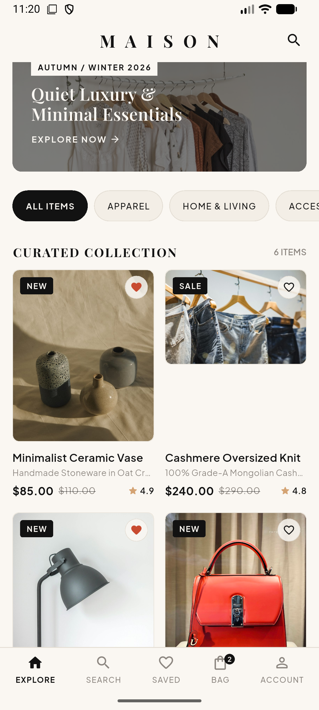
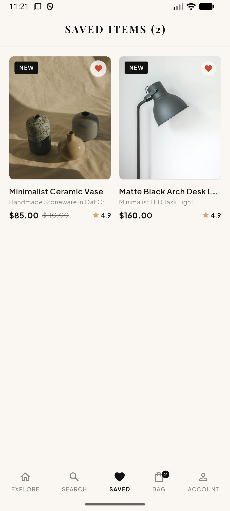
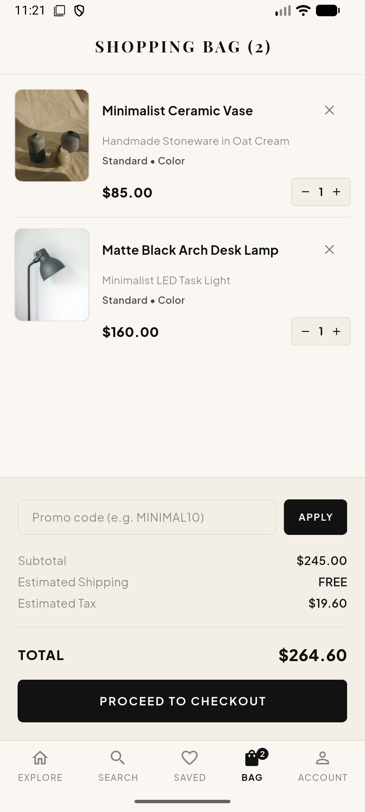
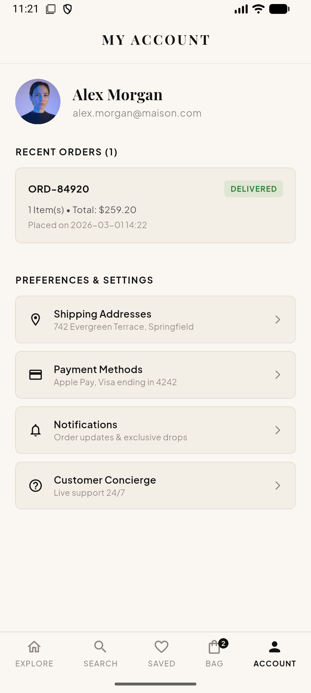

# MAISON - Minimalist Luxury E-Commerce App

A minimalist, high-end e-commerce mobile application built with **Flutter** and powered by a **Python Django REST Framework** backend. Features a warm cream & black aesthetic with quiet luxury design accents.

---

## 📱 App Previews

<p align="center">
  
  &nbsp;&nbsp;
  
</p>

<p align="center">
  
  &nbsp;&nbsp;
  
</p>

---

## 🎨 Theme & Vibe
- **Cream & Black Minimalist Palette**: Warm off-white `#FAF7F2` canvas with deep jet black `#121212` typography and controls.
- **Typography**: `Playfair Display` serif headlines combined with clean `Plus Jakarta Sans` body font.

---

## ⚡ Features
- **Product Catalog**: Filter by categories (Apparel, Home & Living, Accessories, Care & Beauty), search, and sort by price/rating.
- **Interactive Details**: Image gallery, color selection dots, size pills, and quantity controls.
- **Shopping Bag & Promo Codes**: Cart badge counter, item quantity adjustments, and discount code application (`MINIMAL10`, `MAISON20`).
- **Wishlist**: Toggle favorites and save items.
- **Checkout & Orders**: Address entry, payment methods (esewa), order summary, and order history tracking.
- **Django Backend**: Django REST API with SQLite database, seed data management command, and Django Admin panel.

---

## 🚀 Getting Started

### 1. Run Backend (Django REST Framework)
```bash
cd backend
python manage.py migrate
python manage.py seed_data
python manage.py runserver 0.0.0.0:8000
```

### 2. Run Frontend (Flutter)
```bash
cd frontend
flutter pub get
flutter run
```
